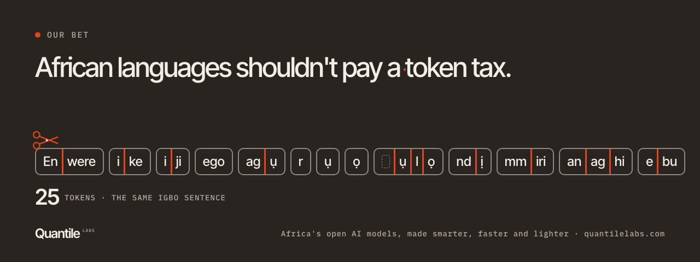

  

# Quantile Labs

**Africa's open AI models, made smarter, faster and lighter.**

AI reads text in small pieces called tokens. Words in African languages get split into more of them than English words, so the same answer is slower and costs more to run. We call this the token tax, and we cut it.

We start from open models built in Africa and teach them to read their own languages in bigger pieces. We choose our quality tests before training, publish the results, and release open weights that run offline on everyday hardware. One country after another, one language after another.

### Models

| Model | Built on | Languages | Links |
|---|---|---|---|
| **WazoCore** | N-ATLaS, Nigeria | Yoruba, Hausa, Igbo | [Model](https://huggingface.co/quantile-labs/WazoCore-8B) · [Code](https://github.com/Quantile-Labs/wazocore) · [Page](https://quantilelabs.com/wazocore/) |
| Next | | | One country after another |

[quantilelabs.com](https://quantilelabs.com) · [Our bet](https://quantilelabs.com/bold-bet/) · [All models](https://quantilelabs.com/models/) · [Hugging Face](https://huggingface.co/quantile-labs)
